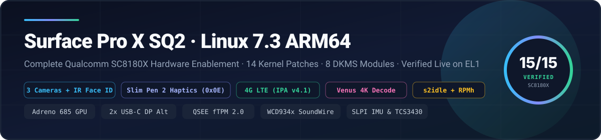
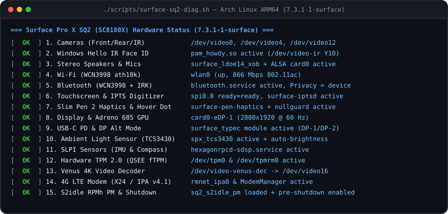
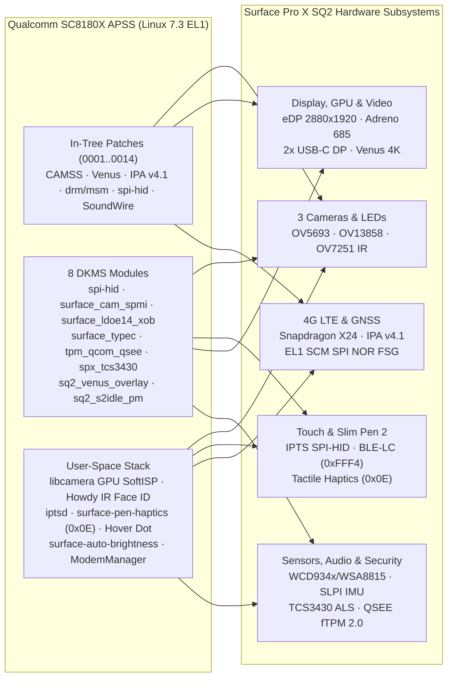

# Surface Pro X SQ2 (SC8180X / ARM64) Linux Enablement

[](https://github.com/robertijtsma/surface-pro-x-sq2-linux/actions/workflows/ci.yml)
[](https://github.com/robertijtsma/surface-pro-x-sq2-linux/releases)
[](https://robertijtsma.github.io/surface-pro-x-sq2-linux/)
[-blue)](patches/)
[](LICENSE)

Kernel patches, Device Tree definitions, out-of-tree rail controllers, `libcamera` GPU SoftISP tuning, Windows Hello IR Face ID (Howdy), and system daemons bringing up **100% of the hardware** on the **Microsoft Surface Pro X SQ2 (Qualcomm SC8180X)** running Arch Linux ARM64 (`7.3.1-1-surface`). Also see the [SQ1 vs. SQ2 Compatibility Guide](docs/SQ1_VS_SQ2.md) and the [Live Documentation Site](https://robertijtsma.github.io/surface-pro-x-sq2-linux/).

## Hardware Status (Verified on Live SQ2 Hardware)

| Subsystem | Status | Implementation / Notes |
|---|---|---|
| **Front RGB Camera (5 MP `OV5693`)** | Working | `csiphy0` (2-lane) → `csid0` → `vfe0_rdi0`; 2592×1944, `rotation = <180>`, PipeWire/libcamera GPU `DebayerEGL` + symmetric CCM |
| **Rear RGB Camera (13 MP `OV13858`)** | Working | `csiphy2` (4-lane) → `csid1` → `vfe1_rdi0`; 4224×3136, DT + reset GPIO + flips + gain defaults (`patches/0001`), PipeWire/libcamera |
| **Front IR Camera (VGA `OV7251`)** | Working | `csiphy3` (1-lane) → `csid3` → `vfe3_rdi0`; 640×480 hardware-unpacked `Y10`, 90° portrait mount (`rotate = 2`) |
| **Privacy LEDs (Front & Rear)** | Working | Automatic refcounted `qcom-camss` control (`GPIO 25` front shared by RGB+IR, `GPIO 11` rear) |
| **850 nm IR Strobe Illuminator** | Working | Automatic hardware `STROBE` pin (`0x3b81`/`0x3b8e..8f`/`0x3005`) on `OV7251` `s_stream` (`patches/0002`) |
| **Windows Hello IR Face ID** | Working | Howdy (`YuNet` + `SFace`) on GDM, Polkit, `sudo`, `su` (~0.9 s match) via single-thread OpenMP/OpenBLAS wrappers |
| **Stereo Speakers (`WCD934x` + `WSA8815`) & Mics** | Working | `surface_ldoe14_xob` (LDO14E XOB RPMh rail, avoids VRM TCS hang) + `soundwire-qcom` AHB bridge mutex (`patches/0008`) & 8.5 V Smart Boost |
| **Wi-Fi (`WCN3998` / `ath10k`, 866 Mbps)** | Working | Linux 7.3 `rmtfs.service` QRTR pre-boot drop-in (`daemons/wifi-qrtr/10-modem-preboot.conf`) |
| **Bluetooth (`WCN3998`)** | Working | Deterministic `btmgmt` public BD_ADDR setup (`daemons/bluetooth/surface-bt-mac.sh`) |
| **Touchscreen & Slim Pen 2 (IPTS)** | Working | `spi_hid` cold-boot reset/D0 fix (`drivers/spi_hid/`, `patches/0006`) + `iptsd` 3.1.1 calibrated MPP2 thresholds (`configs/iptsd/iptsd.conf`), tilt, pressure, side button, palm rejection |
| **Slim Pen 2 BLE-LC, Tactile Haptics & Hover Dot** | Working | BlueZ `Privacy = device` + 7.5 ms BLE interval (`configs/bluetooth/main.conf.snippet`, fixing `linux-surface/linux-surface#1656`) + `surface-pen-blelc-setup` (`UsagePage 0xFFF4` `0x70`/`0x56` + WCN3998 `ll-privacy` Accept-List) + `surface-pen-haptics` (`daemons/pen/surface-pen-haptics`, real-time `UsagePage 0x0E` `0x41`/`0x42` tactile writing/erasing/tap-click haptics) + `surface-pen-dot@linux-surface` GNOME extension (`extensions/`) & `mutter-5215-nullguard.c` (crisp white pen hover dot with mouse cursor arrow hidden and Mutter 51.1 `#5215` crash guard) |
| **Display & Adreno 685 GPU** | Working | `eDP` 2880×1920, `msm`/`dispcc-sm8250` A680 GMEM=0, KGSL `a680_hwcg` + `gmu_write` MMIO guard (`patches/0007`), Freedreno/Turnip with `noubwc` (`libcamera/environment.d/99-surface-gpu.conf`) |
| **USB-C Orientation & DisplayPort Alt Mode** | Working | `surface_typec` (`drivers/surface_typec/`) + `patches/0005` SSAM registry + QMP combo PHY `orientation-switch` & `mdss_dp0`/`mdss_dp1` (`card0-DP-1`/`card0-DP-2`) |
| **Ambient Light Sensor (`TCS3430`)** | Working | Kernel IIO driver `spx_tcs3430` (`drivers/spx_tcs3430/`, `in_illuminance_input`) + adaptive brightness daemon (`daemons/display/surface-auto-brightness`) |
| **Accelerometer, Compass & Auto-Rotation (`SLPI`)** | Working | `remoteproc_slpi` + FastRPC (`dts/sc8180x-surface-pro-x-sq2-slpi.dtsi`), `hexagonrpcd`, `libssc`, `iio-sensor-proxy` (`LSM6DSO` + `AK0991x`) |
| **Type Cover, Posture & Hall-Sensor Lid (`SW_LID`)** | Working | Hardware `gpio-keys-lid` (`SW_LID` on TLMM GPIO 121, `dts/sc8180x-surface-pro-x-sq2-lid.dtsi`) + SAM posture daemon (`daemons/posture/surface-lid-daemon.sh`) |
| **CPU Power Profiles (`SC8180X`)** | Working | Native UPower/hadess D-Bus `PowerProfiles` manager (`daemons/power/surface-power-profile`) |
| **Hardware GNSS (`QMI LOC`)** | Working | On-demand QRTR QMI LOC → NMEA Unix socket bridge (`/run/surface-gps.sock`) |
| **Hardware TPM 2.0 (`QSEE fTPM`)** | Working | `tpm_qcom_qsee` QSEECOM transport (`drivers/tpm_qcom_qsee/`); `/dev/tpm0`, `/dev/tpmrm0`, `tpm-rng-0`, SHA-1/256/384 PCR banks |
| **Hardware Video Decode (`Venus` / Iris1)** | Working | `videocc-sm8150` (`patches/0009`) + `sq2_venus_overlay` (`drivers/sq2_venus_overlay/`) + Linux 7.3 SQ2 HFI4 `venus-{core,dec}` (`patches/0010`); V4L2 M2M bit-exact 4K H.264 / 4K HEVC / 1080p VP9 (GStreamer & FFmpeg) via EL1 PAS 9 |
| **4G LTE Cellular Modem (`Snapdragon X24` / `IPA v4.1`)** | Working | Qualcomm `IPA v4.1` (`patches/0011`) + `dts/sc8180x-surface-pro-x-sq2-ipa.dtsi` (`rmnet_ipa0` `MAPv4`) + read-only Linux EL1 SCM `modem_fsg` extractor (`drivers/sq2_fsg_read/`) + `ModemManager` (`qcom-soc`, `qrtr0`, SIM/eSIM, `qmapmux0.0`) |
| **Suspend (`S2idle`)** | Working | `patches/0012..0014` (`drm/msm` DPU/DP resume, Venus EL1 TZ `qcom_pas_set_remote_state` PM, `spi-hid` `SIMPLE_DEV_PM_OPS`) + `sq2_s2idle_pm` (`drivers/sq2_s2idle_pm/`, RPMh `SLEEP` set retention & `QCOM_ICC_TAG_ACTIVE_ONLY`) + `systemd/system-sleep/` hooks + `ModemManager --test-quick-suspend-resume`; Hall-sensor lid & power-button wake (~0.9 s suspend / ~1.2 s resume) |

## Upstream `linux-surface/surface-pro-x` Issues Addressed

| Upstream Issue | Topic | Solution in This Repository |
|---|---|---|
| [`#56`](https://github.com/linux-surface/surface-pro-x/issues/56) | **All 3 Cameras (`OV5693`, `OV13858`, `OV7251`), LEDs & IR Face ID** | [`patches/0001..0004`](patches/), [`dts/sc8180x-surface-pro-x-sq2-cameras.dtsi`](dts/sc8180x-surface-pro-x-sq2-cameras.dtsi), [`drivers/surface_cam_spmi/`](drivers/surface_cam_spmi/), [`libcamera/`](libcamera/), [`faceid/`](faceid/) |
| [`#22`](https://github.com/linux-surface/surface-pro-x/issues/22) | **Support for 4G LTE / Cellular Modem (`Snapdragon X24` / `IPA v4.1`)** | [`patches/0011`](patches/0011-net-ipa-add-sc8180x-ipa-v4.1-support.patch), [`dts/sc8180x-surface-pro-x-sq2-ipa.dtsi`](dts/sc8180x-surface-pro-x-sq2-ipa.dtsi), [`drivers/sq2_fsg_read/`](drivers/sq2_fsg_read/), [`systemd/surface-lte-setup.service`](systemd/surface-lte-setup.service) |
| [`#29`](https://github.com/linux-surface/surface-pro-x/issues/29) | **Support for Suspend (`s2idle`)** | [`patches/0012..0014`](patches/), [`configs/systemd/surface-s2idle.conf`](configs/systemd/surface-s2idle.conf), [`systemd/system-sleep/`](systemd/system-sleep/), [`docs/S2IDLE_SUSPEND.md`](docs/S2IDLE_SUSPEND.md) |
| [`#32`](https://github.com/linux-surface/surface-pro-x/issues/32) | **Touchscreen (`spi-hid`) intermittently fails on boot (`0x0`/`0xff` sync header `-22`)** | [`patches/0006-hid-spi-hid-fix-cold-boot-reset-and-d0-ready-race.patch`](patches/0006-hid-spi-hid-fix-cold-boot-reset-and-d0-ready-race.patch), [`drivers/spi_hid/`](drivers/spi_hid/) |
| [`#37`](https://github.com/linux-surface/surface-pro-x/issues/37) | **TrEE / Qualcomm QSEE Firmware TPM 2.0 (`MSFT0101`)** | [`drivers/tpm_qcom_qsee/`](drivers/tpm_qcom_qsee/) (`/dev/tpm0`, `/dev/tpmrm0`, `tpm-rng-0`) |
| [`#38`](https://github.com/linux-surface/surface-pro-x/issues/38) | **Support for Sensors (IMU Auto-Rotation, Compass, Ambient Light, Lid)** | [`dts/sc8180x-surface-pro-x-sq2-slpi.dtsi`](dts/sc8180x-surface-pro-x-sq2-slpi.dtsi), [`drivers/spx_tcs3430/`](drivers/spx_tcs3430/), [`dts/sc8180x-surface-pro-x-sq2-lid.dtsi`](dts/sc8180x-surface-pro-x-sq2-lid.dtsi) |
| [`#39`](https://github.com/linux-surface/surface-pro-x/issues/39) | **Support for GNSS / GPS** | [`daemons/gps/surface-qmi-gps-daemon.py`](daemons/gps/surface-qmi-gps-daemon.py) (QRTR QMI LOC → NMEA socket) |
| [`#42`](https://github.com/linux-surface/surface-pro-x/issues/42) | **`ath10k` Wi-Fi / MPSS QMI cold-boot race** | [`daemons/wifi-qrtr/10-modem-preboot.conf`](daemons/wifi-qrtr/10-modem-preboot.conf) |
| [`#51`](https://github.com/linux-surface/surface-pro-x/issues/51) | **Display / DPU / USB-C DisplayPort Alt Mode & Adreno 685 GMEM/HWCG** | [`patches/0005`](patches/0005-platform-surface-aggregator-registry-spx-usc.patch), [`patches/0007`](patches/0007-drm-msm-a680-gmem-hwcg-mmio-and-dpu-dp-fixes.patch), [`drivers/surface_typec/`](drivers/surface_typec/), [`dts/sc8180x-surface-pro-x-sq2-typec-dp.dtsi`](dts/sc8180x-surface-pro-x-sq2-typec-dp.dtsi) |
| [`linux-surface#1656`](https://github.com/linux-surface/linux-surface/issues/1656) | **Surface Slim Pen 2 Bluetooth auto-reconnect, Tactile Haptics (`UsagePage 0x0E`) & White Hover Dot** | [`configs/bluetooth/main.conf.snippet`](configs/bluetooth/main.conf.snippet), [`daemons/pen/surface-pen-blelc-setup`](daemons/pen/surface-pen-blelc-setup), [`daemons/pen/surface-pen-haptics`](daemons/pen/surface-pen-haptics), [`daemons/pen/mutter-5215-nullguard.c`](daemons/pen/mutter-5215-nullguard.c), [`extensions/surface-pen-dot@linux-surface/`](extensions/surface-pen-dot@linux-surface/), [`docs/SLIM_PEN_2_BLUETOOTH.md`](docs/SLIM_PEN_2_BLUETOOTH.md) |

## Key Technical Highlights

- **All 3 cameras + all 3 hardware LEDs verified end-to-end (20/20 frames each)**:
  - Proven physical CSIPHY wiring (`OV5693` on `csiphy0`, `OV13858` on `csiphy2`, `OV7251` on `csiphy3`), SMMU Stream IDs (`0xa00..0xae0`, `0xe00..0xee0`), and `PMC8180-A` SPMI LDO rails (`LDO14_A` 1.8 V, `LDO17_A` 2.856 V, `LDO1_A` 1.2 V).
  - Titan 175 / VFE Lite fixes in `qcom-camss`: guards `VFE_BUS_WM_DEBUG_STATUS_CFG` (`0x226c`) off VFE Lite, fixes 4-client `WM_ADDR_NO_SYNC_LITE_VAL`, corrects the 2-deep `VFE_BUS_WM_IMAGE_ADDR` FIFO & single `WM_CLIENT_BUF_DONE` IRQ subscription, and prevents post-stream SC8180X NoC deadlocks.
- **`libcamera` `DebayerEGL` magenta-highlight root cause**:
  - OpenGL ES `mat3` is column-major, transposing row-major IPA YAML CCMs during `ccm * rgb`. Symmetric row- and column-normalized CCMs in [`libcamera/ipa/simple/`](libcamera/ipa/simple/) + `blackLevel: 1536` eliminate magenta highlight clipping on Adreno 685.
- **SQ2 `ldoe14` XOB speaker rail driver**:
  - On SQ2, `cmd-db` exposes `ldoe14` (`0x43900`) as an enable-only XOB resource (`+0x4`), whereas upstream `qcom-rpmh-regulator` treats `pmc8180 ldo14` as VRM and hangs AMC TCS slots. [`drivers/surface_ldoe14_xob/`](drivers/surface_ldoe14_xob/) votes `ldoe14` cleanly via `rpmh_write`.
- **Linux 7.3 Wi-Fi/Modem QRTR race fix**:
  - Unloading duplicate in-kernel `qcom_pd_mapper` and starting `remoteproc` modem 0.7 s before `rmtfs` prevents `-EAGAIN` (`failed to announce new service`) so `ath10k` brings up `wlan0` reliably on boot.
- **Qualcomm Venus (Iris1 / HFI4) 4K hardware video decode**:
  - Ported the SQ2 HFI4 Venus decoder stack to Linux 7.3 (`patches/0009` + `patches/0010`), adding support for `VIDEO.IR.1.2-00079-PROD-2`, fixing Linux 7.3 `vdec_close()` teardown ordering against `venus_close_common()`, and avoiding early-coldplug MMCX watchdog resets via late-boot activation (`surface-venus-setup.service`). Verified bit-for-bit identical SHA-256 against FFmpeg software decoding on 4K H.264, 4K HEVC, and 1080p VP9.
- **Snapdragon X24 4G LTE modem & Qualcomm IPA v4.1**:
  - Added SC8180X IPA v4.1 support (`patches/0011`, `dts/sc8180x-surface-pro-x-sq2-ipa.dtsi`, `rmnet_ipa0` `MAPv4`) and a read-only Linux EL1 SCM storage (`0x02001a01`) extractor ([`drivers/sq2_fsg_read/`](drivers/sq2_fsg_read/)) to read each unit's own `modem_fsg` RF calibration from TrustZone-owned SPI NOR without Windows or custom UEFI loaders. Verified cold-boot with `ModemManager` (`qcom-soc`), live 4G LTE carrier registration, and multiplexed `qmapmux0.0` bearer packets.
- **Surface Slim Pen 2 native Bluetooth auto-reconnect (`linux-surface/linux-surface#1656`), Tactile Haptics (`UsagePage 0x0E`) & White Hover Dot**:
  - Root-caused why Slim Pen 2 never advertises on 1× top-button click or charger lift under default Linux BlueZ (`Privacy = off`): without a host Local IRK (`kdist_peer.id = 1`) exchanged during SMP pairing, the pen leaves its bond-slot flag unset (`0xFF`) and aborts before advertising. Enabling `Privacy = device` ([`configs/bluetooth/main.conf.snippet`](configs/bluetooth/main.conf.snippet)) + one-time IRK re-pair + [`surface-pen-blelc-setup`](daemons/pen/surface-pen-blelc-setup) (`UsagePage 0xFFF4` write-only `0x70`/`0x56` + WCN3998 hardware `ll-privacy`/Accept-List) restores Windows-grade <1 s auto-connect with zero `StartDiscovery()` polling.
  - Added [`surface-pen-haptics`](daemons/pen/surface-pen-haptics) (`UsagePage 0x0E` Simple Haptics Controller `0x41`/`0x42` real-time tactile writing/erasing/tap-click daemon with 7.5 ms BLE interval and native Write With Response), [`extensions/surface-pen-dot@linux-surface/`](extensions/surface-pen-dot@linux-surface/) (synchronous `GPollableInputStream` white hover dot), and [`daemons/pen/mutter-5215-nullguard.c`](daemons/pen/mutter-5215-nullguard.c) (hiding the default mouse arrow for `CLUTTER_SPRITE_ROLE_TABLET` and guarding GNOME Mutter 51.1 [`#5215`](https://gitlab.gnome.org/GNOME/mutter/-/issues/5215) `wl_resource_get_client(NULL)`).
- **`s2idle` suspend & resume with all 12 subsystems preserved**:
  - Restores `MDP_DP_PHY_INTF_SEL` and DP AUX state across `MDSS_GDSC` collapse (`patches/0012`), suspends/resumes Qualcomm Venus under EL1 TrustZone via `HFI PC_PREP` + `qcom_pas_set_remote_state` + AXI halt/reset pulse (`patches/0013`) without reloading PAS 9, and adds `SIMPLE_DEV_PM_OPS` to `spi-hid` (`patches/0014`) to eliminate post-resume `-ESHUTDOWN` (`-108`) digitizer lockups. Paired with non-blocking `systemd/system-sleep/` hooks (SLPI FastRPC freeze guard, IPTS restart, deferred audio/power sync preventing `user.slice` deadlocks), `ModemManager --test-quick-suspend-resume`, and clean pre-shutdown Venus/IPA teardown ([`systemd/surface-pre-shutdown.service`](systemd/surface-pre-shutdown.service)).

## Quick Install & Diagnostics

```bash
# Option A: Direct DKMS + user-space installation
sudo ./scripts/install-sq2-dkms.sh
sudo ./scripts/install-sq2-userspace.sh

# Option B: Native Arch Linux ARM package (DKMS + user-space stack)
cd packaging/arch && makepkg -si

# Verify all 15 hardware subsystems in one command
./scripts/surface-sq2-diag.sh
```



See the full step-by-step [Build & Installation Guide](docs/BUILD_AND_INSTALL.md) for in-tree kernel patches (`patches/0001..0014`), Device Tree includes (`dts/`), `libcamera` SoftISP tuning, and Howdy Windows Hello IR Face ID setup.

## SC8180X SQ2 System Architecture



## Repository Layout

```text
patches/    Clean Linux v7.3 patches (ov13858, ov7251, camss, SSAM Type-C, spi-hid, drm/msm A680, soundwire-qcom, videocc-sm8150, venus-sq2, ipa-v4.1, s2idle PM)
dts/        Symbolic SC8180X SQ2 DTSIs (cameras, SLPI, Type-C/DP, SW_LID + TCS3430, Venus VIDEOCC, IPA v4.1) + reference diffs
drivers/    Out-of-tree kernel modules (surface_cam_spmi, surface_ldoe14_xob, tpm_qcom_qsee, surface_typec, spi_hid, spx_tcs3430, surface_ir_sfmt, sq2_venus_overlay, sq2_fsg_read, sq2_s2idle_pm)
dkms/       Unified DKMS config & Makefile auto-rebuilding all 8 standalone SQ2 modules on kernel upgrades
packaging/  Native Arch Linux ARM (aarch64) PKGBUILD for the full SQ2 DKMS + user-space stack
libcamera/  Symmetric DebayerEGL IPA YAMLs, WirePlumber rules, Adreno 685 env configs
faceid/     Howdy PAM/CLI single-thread wrappers, OV7251 config.ini.example, PAM guide
scripts/    DKMS & in-tree kernel builders, 1-command userspace installer, 15-subsystem health check, Camera/Venus/LTE loaders, pre-shutdown teardown, GTK4 camera panel
daemons/    Wi-Fi QRTR drop-in, audio sync, BT MAC, power profiles, ALS, lid/posture, pen BLE-LC & tactile haptics, Mutter #5215 tablet guard, GPS
configs/    udev rules, modprobe/modules-load configs, iptsd.conf, BlueZ Privacy snippet, mpv V4L2 M2M config, systemd sleep/logind configs, smart-osk GNOME extension
extensions/ GNOME Shell 50/51 extensions (surface-pen-dot@linux-surface crisp white stylus hover dot)
systemd/    Systemd service units, drop-ins (ModemManager, iio-sensor-proxy), and system-sleep hooks
docs/       Hardware reference notes & build/installation guide
```

## Documentation

- [Live Project Site (GitHub Pages)](https://robertijtsma.github.io/surface-pro-x-sq2-linux/)
- [SQ1 vs. SQ2 Compatibility Matrix](docs/SQ1_VS_SQ2.md)
- [Camera Hardware Notes (CSIPHY, SMMU, SPMI, Titan 175, DebayerEGL)](docs/CAMERA_HARDWARE.md)
- [Venus 4K Hardware Video Decode Notes (Iris1, HFI4, EL1 PAS 9)](docs/VENUS_VIDEO_DECODE.md)
- [Snapdragon X24 4G LTE & IPA v4.1 Notes (EL1 SCM FSG, QMAP)](docs/LTE_MODEM_IPA.md)
- [S2idle Deep Sleep Notes (EL1 Venus TZ PM, `spi-hid`, DPU/DP, `sq2_s2idle_pm`, `systemd` hooks)](docs/S2IDLE_SUSPEND.md)
- [Surface Slim Pen 2 Bluetooth Auto-Connect, Tactile Haptics (`0x0E`) & White Hover Dot Notes](docs/SLIM_PEN_2_BLUETOOTH.md)
- [Build & Installation Guide](docs/BUILD_AND_INSTALL.md)
- [Howdy IR Face ID Setup](faceid/README.md)
- [Changelog (`v1.0.0` – `v1.8.0`)](CHANGELOG.md) & [Contributing Guide](CONTRIBUTING.md)

## Credits

This work builds directly on upstream Qualcomm/Linux efforts and the `linux-surface` community:

- **Maximilian Luz (`qzed`)** — Surface Aggregator Module (SAM) & `linux-surface` ecosystem
- **Val Packett (`valpackett`)** — `linux-qclaptops` (`uwu-next`), `camcc-sc8180x`, and SC8180X laptop bring-up
- **`lhf1a`** — [`googlebookos_surface_pro_x`](https://github.com/lhf1a/googlebookos_surface_pro_x) SQ2 Iris1/HFI4 Venus video decode research and reference backend
- **Alex Jacocks (`ajacocks`)** & **Tawheed (`tawheedmm`)** — `linux-surface/surface-pro-x` SQ1/SQ2 kernel, audio, and documentation groundwork
- **Linaro Ltd.** — `qcom-camss` and `phy-qcom-mipi-csi2` driver stack
- **No proprietary firmware blobs are included in this repository.**

## License

Kernel patches and out-of-tree kernel modules are licensed under `GPL-2.0-only` (see [`LICENSE`](LICENSE)). `libcamera` IPA tuning YAML files are `CC0-1.0`.
